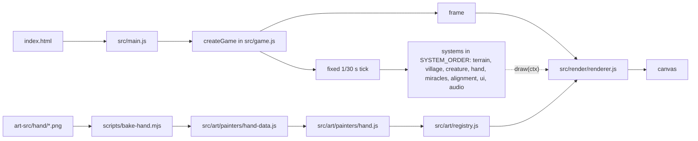
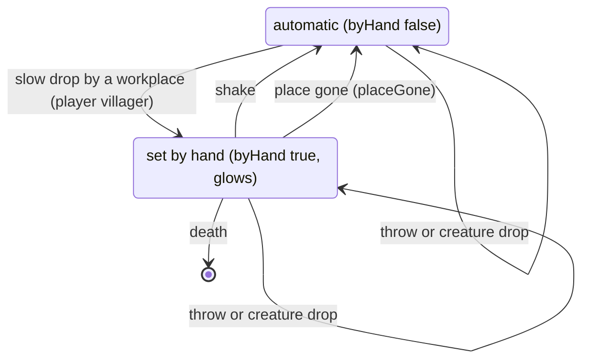

# Architecture

> System flow, auth strategy, state management, cross-cutting structure. Keep it terse: pointers into code, not essays.

Engine doc: `docs/architecture.md`; quoted names below are its section headings. Commands: `commands.md`. No auth: static browser game.

## System flow (doc: "The game object", "Systems", "Game systems")
- Entry chain: `index.html` → `src/main.js` → `createGame` in `src/game.js`.
- System order: `SYSTEM_ORDER` in `src/game.js`.
- System entry modules: `<name>.js` in `src/systems/`; internals in `src/<name>/` (e.g. `src/village/sim.js`).

## Rendering (doc: "Rendering", "Display", "Coordinates")
- Renderer (frame order): `src/render/renderer.js`
- Draw list: `src/render/drawlist.js`; blit: `src/render/blit.js`
- Display (pixel scale, view size): `src/engine/display.js`
- Iso math (projection, picking): `src/world/iso.js`
- Sprite registry: `src/art/registry.js`
- Palette: `src/art/palette.js`; LUT: `src/art/lut.js`
- Effects layer: `src/render/fx.js`; its faster pixelfx glow: `src/render/glow.js`
- Copies of pixelfx effects with caches (same pixels): rain cloud `src/miracles/rain-cloud.js`, burning flames `src/miracles/flames.js`

## State (doc: "The game object")
- Game object: `createGame` in `src/game.js`.
- `game.state`: not built by `createGame`; search `game.state ??=` for where it is created.
- World model: `src/world/world.js`
- Events bus: `src/engine/events.js`
- Creature brain: `src/creature/brain.js`
- Dev hooks (`window.__game`): `src/dev/hooks.js`

## Villager jobs (`src/village/sim.js`)
- `assign()` deals jobs in tiers every `assignInterval`; a villager with `byHand` keeps its job and fills that tier's slot.
- Hand drops: `release` / `landed` events → `dropAssign()`; `thrown`, `shaken` or `by: 'creature'` puts the id in `keepJob` (no job set). Only player villagers get `byHand`.
- `placeGone()` clears `byHand` when the job's place is gone; glow (`JOB_GLOW`, `src/art/painters/villagers.js`) follows `byHand` in the village draw key.

## Checks
`commands.md`; doc section "Checks".
